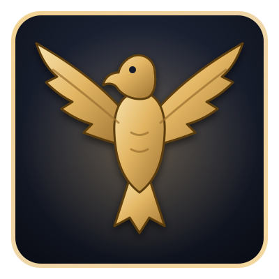
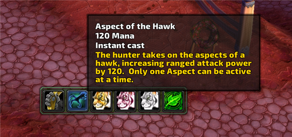
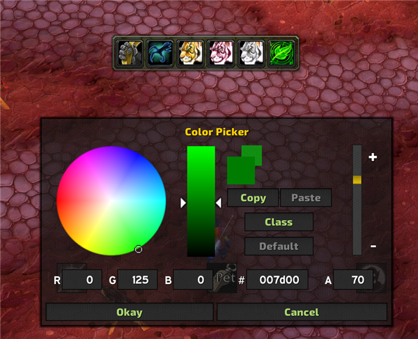

**Every hunter aspect on one small bar, made for WoW Forever.**

Monkey, Hawk, Cheetah, Beast, Pack and Wild as clickable buttons with cooldowns and keybinds, sitting above your action bars or anywhere you drag it. Originally by **Floraline** (MPL 2.0), maintained for WoW Forever by **paradosi-Dreamscythe**.

**WoW Forever only** (interface 16001). Version 1.3.0 was the last for Classic Era and TBC Anniversary; it stays downloadable but gets no updates.

## Features

- **One click per aspect.** Left-click to cast; hover for the spell's tooltip.
- **Keybinds.** Uses the game's Shapeshifting bindings (Key Bindings > Action Bar > Shapeshifting).
- **Your order, your aspects.** Drag spells on and off the bar to reorder it; hide the aspects you don't use.
- **Where you want it.** Automatic (above your action bars), locked, or unlocked to drag anywhere.
- **Your look.** Background colour and opacity, borders on or off, scale from 50% to 200%.
- **Settings panel** in the same navy-and-gold look as the author's other WoW Forever addons: Esc > Options > AddOns > FloAspectBar Forever, or **Options...** in the bar's right-click menu.
- **Minimap button.** Left-click for settings, right-click to lock or unlock, drag to move it. It can be turned off; the addon is also in the addon compartment.

## Slash commands

| Command | Does |
|---|---|
| `/fab` | Help, the version and the GitHub link |
| `/fab options` | Open the settings panel |
| `/fab minimap` | Show or hide the minimap button |
| `/fab lock` / `/fab unlock` | Lock the bar, or unlock it to drag |
| `/fab auto` | Place it automatically above your action bars |
| `/fab scale <num>` | Set the scale, e.g. `/fab scale 1.5` |
| `/fab borders` / `/fab noborders` | Show or hide borders |
| `/fab show` | Bring back aspects you hid |
| `/fab status` | What's on the bar, what's hidden, where it is |
| `/fab reset` | Reset all settings (reloads the UI) |

## Works well with

**[FloTotemBar](https://github.com/paradosi/FloTotemBar-Classic)**: its trap bar docks to the right of the aspect bar.

## Help and bug reports

The settings panel shows the installed version, and its **Help and bug reports** button gives you the GitHub address to copy. Source, full documentation and issue tracker: [github.com/paradosi/FloAspectBar-Classic](https://github.com/paradosi/FloAspectBar-Classic)

Licence: Mozilla Public License 2.0. The bundled fonts (Oswald, JetBrains Mono) are under the SIL Open Font License.
