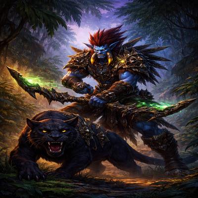
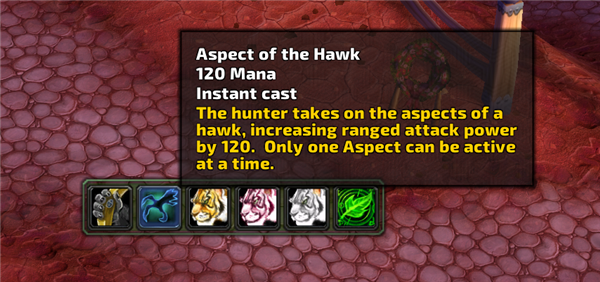
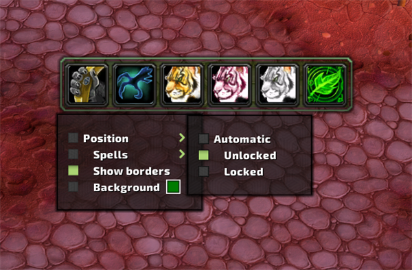
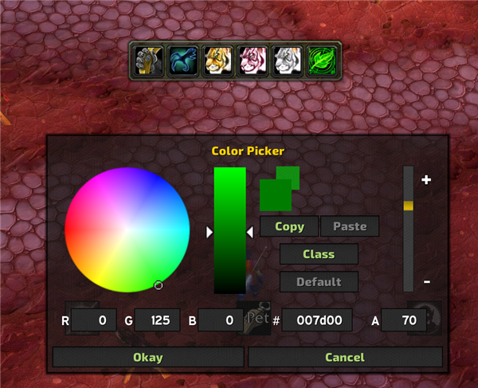

  

<h1 align="center" style="color:#AAD372;">FloAspectBar — Classic</h1>

A Hunter aspect bar addon for **WoW Forever**. Displays Hunter aspects as clickable buttons with cooldown tracking and keybinding support.

Originally created by **Floraline** (MPL 2.0). Ported to Classic by **paradosi-Dreamscythe**.

## Features

- **Hunter Aspects** — Monkey, Hawk, Cheetah, Beast, Pack, Wild
- **Click to cast** — Left-click any aspect to activate it
- **Tooltip support** — Hover for full spell details
- **Keybinding support** — Uses WoW's Shapeshifting keybindings (Key Bindings > Action Bar > Shapeshifting)
- **Drag to reorder** — Drag spells on/off the bar to customize button order
- **Position modes** — Automatic, locked, or unlocked (drag to move)
- **Customizable background** — Color picker with opacity slider
- **Show/hide borders** — Toggle bar borders via right-click menu
- **Per-spell visibility** — Hide aspects you don't use
- **Scalable** — Adjust bar scale in the settings or via slash command
- **Settings panel** — Esc > Options > AddOns > FloAspectBar, or **Options...** in the bar's right-click menu
- **Minimap button** — Left-click for settings, right-click to lock/unlock the bar, drag to move it; can be turned off (WoW Forever also lists the addon in the addon compartment)

## Screenshots

## Help and bug reports

The bottom of the settings panel (*Esc > Options > AddOns > FloAspectBar*) shows the installed version
and a **GitHub link** button with this repository's address ready to copy. Please
[open an issue](https://github.com/paradosi/FloAspectBar-Classic/issues) for problems.

## Slash Commands

| Command | Description |
|---------|-------------|
| `/fab` | Show help |
| `/fab options` | Open the settings panel |
| `/fab minimap` | Show or hide the minimap button |
| `/fab lock` | Lock bar position |
| `/fab unlock` | Unlock bar (drag to move) |
| `/fab auto` | Automatic positioning above action bars |
| `/fab scale <num>` | Set bar scale (e.g. `/fab scale 1.5`) |
| `/fab borders` | Show borders |
| `/fab noborders` | Hide borders |
| `/fab show` | Bring back aspects hidden from the bar's right-click menu |
| `/fab status` | Show what is on the bar, what is hidden, and where the bar is |
| `/fab reset` | Reset all settings (reloads UI) |

## Installation

1. Download and extract to WoW Forever's AddOns folder: `_forever_/Interface/AddOns/FloAspectBar/`

2. Log in on a Hunter character
3. The aspect bar appears automatically above your action bars

## Compatibility

**WoW Forever** (Interface 16001) only.

> [!IMPORTANT]
> **WoW Forever only from the next release.** Version 1.3.0 is the last one for Classic Era and
> TBC Anniversary. It stays downloadable on CurseForge, Wago and GitHub Releases, but gets no
> further updates.

## License

[Mozilla Public License 2.0](http://mozilla.org/MPL/2.0/)
